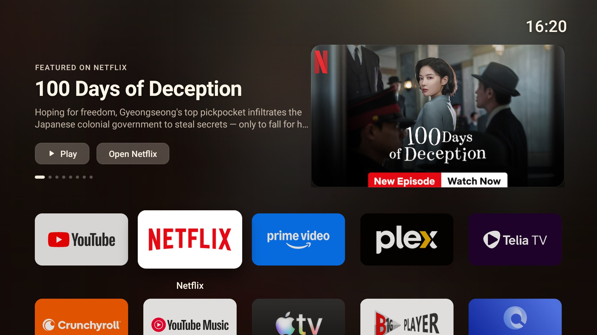
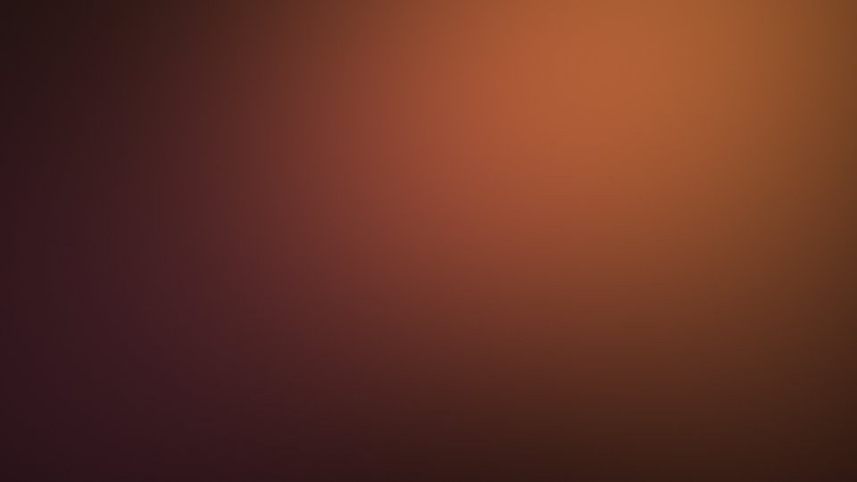

# Uzi TV Launcher

Lightweight, warm, Apple TV–inspired home screen for Android TV.
Built for a Xiaomi Mi Box 4 (Android 9, 2 GB RAM) — ~250 KB APK, no background services, no tracking.

## Features
- **Top Shelf** for the focused app: full-screen showcase of its *Up Next* and featured titles (read from Android TV's shared channel database), with **Play / Resume**, **Open app**, page dots and auto-rotation every 7 s
- Low-res artwork shown as a crisp card over a soft ambient blur; high-res artwork goes full-bleed with a slow push-in
- App grid with clear focus: 1.12× zoom, deep soft shadow, light sheen, name under the tile; other tiles subtly dimmed
- Warm theme: amber / terracotta wallpaper, warm blacks and off-whites
- Hold **OK** on a tile: move / hide / app info. Hold **OK** on the gear: show hidden apps, reset order, refresh Top Shelf

## Remote
| Where | Key | Action |
|---|---|---|
| Top row of apps | ↑ | Into the Top Shelf (on Play) |
| Top Shelf | ← on Play / → on Open | Previous / next title |
| Top Shelf | ↓ or Back | Back to the app tile |
| Any tile | Hold OK | Tile options |

## Wallpaper

## Build & install
- GitHub Actions builds every push and publishes `uzi-tv-launcher.apk` to the [`latest` release](../../releases/tag/latest).
- Install: `adb install -r uzi-tv-launcher.apk`
- Top Shelf needs: `adb shell pm grant ee.uzi.tvlauncher android.permission.READ_TV_LISTINGS`
- Optional stable signing: add repo secrets `UZI_KEYSTORE_B64` and `UZI_KEYSTORE_PASS`.
